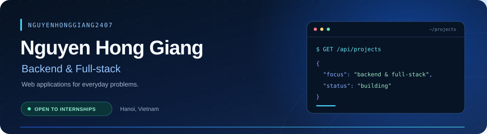

  

I'm **Nguyễn Hồng Giang**, an IT student in Hanoi building practical web applications. My focus is Java, Spring Boot, APIs and databases. I also work with React, Node.js, FastAPI and PHP where a project calls for them.

I'm looking for a **part-time Backend / Full-stack internship in Hanoi**, with mentorship and an opportunity to grow with the team.

## Tools used in my projects

| Area | Technologies with source examples below |
| --- | --- |
| Backend | Java 17, Spring Boot, REST APIs, Node.js / Express, Python / FastAPI, PHP |
| Frontend | React, TypeScript, JavaScript, HTML, CSS |
| Data | MySQL, PostgreSQL, SQLite, H2 for local Java demos |
| Development | Git, GitHub Actions, Maven, Docker |

## Featured projects

Screenshots show the actual project interfaces with demonstration data. They do not represent customer activity. Open each repository for setup, test commands, limitations and credits.

### [RunwayStudio](https://github.com/nguyenhonggiang2407/RunwayStudio)

A Java fashion storefront with Outfit Studio, Shop The Scene, a private wardrobe and COD checkout.

**Java 17 · Spring Boot · JPA · H2 / MySQL · Docker** · Transactional checkout, stock locking and per-account idempotency.

[Source & setup](https://github.com/nguyenhonggiang2407/RunwayStudio) · [Demo](https://runwaystudio-portfolio-demo.onrender.com)

### [FORME](https://github.com/nguyenhonggiang2407/FORME)

A wardrobe and weekly outfit planner inspired by Runway, with a 12-piece demonstration wardrobe and six editorial inspiration looks. Build outfits with deterministic rules, plan the week and generate a packing list with repeated pieces merged.

**Vanilla JavaScript · HTML / CSS · Browser-local persistence** · Saved outfits, calendar and packing checklist, with JSON backup and restore. Data stays in the current browser.

[Source & setup](https://github.com/nguyenhonggiang2407/FORME) · [Demo](https://nguyenhonggiang2407.github.io/FORME/)

### [YangAtlas](https://github.com/nguyenhonggiang2407/YangAtlas)

A visual travel planner with day-by-day itineraries, group budgets and calendar export. Real licensed destination photography, an original coordinate schematic and browser-local data.

**Vanilla JavaScript · HTML / CSS · Local storage** · Strict JSON restore, time-overlap checks, duration-preserving reorder and Unicode-safe ICS export. Tested with 19 domain checks and 10 browser workflows; sample costs are fictional, editable estimates.

[Source & setup](https://github.com/nguyenhonggiang2407/YangAtlas) · [Live Demo](https://nguyenhonggiang2407.github.io/YangAtlas/) · [Photo credits](https://github.com/nguyenhonggiang2407/YangAtlas/blob/main/docs/MEDIA.md)

### [YangRent](https://github.com/nguyenhonggiang2407/YangRent)

A rental housing app for room discovery, booking requests, contracts, invoices and maintenance.

**React · FastAPI · SQLAlchemy · PostgreSQL / SQLite** · Role checks and record ownership in the backend. The pictured frontend uses fictional API fixtures. The public full-stack demo runs on Render Free with six fictional room types and temporary SQLite data; registration, login and favorites were verified on 4 November 2026.

[Source & setup](https://github.com/nguyenhonggiang2407/YangRent) · [Live Demo](https://yangrent-portfolio-demo.onrender.com/)

### [CampusDesk](https://github.com/nguyenhonggiang2407/CampusDesk)

A campus support desk where students submit requests and staff manage assignments, replies and internal notes.

**React · TypeScript · Express · SQLite** · Server-side role checks and version-based conflict detection.

[Source & setup](https://github.com/nguyenhonggiang2407/CampusDesk) · [Demo](https://giang-campusdesk.onrender.com)

### [YangHomestay](https://github.com/nguyenhonggiang2407/YangHomestay)

A Hanoi homestay booking project with search, availability, booking management and server-side pricing.

**PHP · JavaScript · Supabase PostgreSQL** · Backend authorization and price calculation; see the repository for deployment requirements.

[Source & setup](https://github.com/nguyenhonggiang2407/YangHomestay) · [Demo](https://yanghomestay.helioho.st/)

### [YangLingo](https://github.com/nguyenhonggiang2407/YangLingo)

An English learning workspace with vocabulary books, spaced review and short practice sessions.

**PHP · MySQL · JavaScript** · Progress and review schedules are scoped to each account.

[Source & setup](https://github.com/nguyenhonggiang2407/YangLingo) · [Demo](https://yangcute.helioho.st/)

### [ApplyFlow](https://github.com/nguyenhonggiang2407/ApplyFlow)

An internship application tracker with a status pipeline, follow-up tasks and calendar export.

**React · TypeScript · Express · SQLite** · Account-scoped data and version checks for competing edits.

[Source & setup](https://github.com/nguyenhonggiang2407/ApplyFlow) · [Demo](https://giang-applyflow.onrender.com)

Demo landing pages and available public health/catalog endpoints were checked on **3 November 2026**. This is a point-in-time check, not an uptime guarantee or a complete checkout audit. Render Free demos may wake slowly, and temporary H2/SQLite data can reset. Use fictional details.

## Independent backend projects

These six repositories preserve the source history and credits from their original DTDD branches. Each has its own setup guide, tests and CI; public application demos are not yet verified.

| Project | Backend focus |
| --- | --- |
| [YangSlots](https://github.com/nguyenhonggiang2407/YangSlots) | Java / Spring Boot · Transactional capacity checks, expiring holds and idempotency |
| [YangDocs](https://github.com/nguyenhonggiang2407/YangDocs) | FastAPI / SQLite FTS5 · Private documents and page-addressable search evidence |
| [YangQueue](https://github.com/nguyenhonggiang2407/YangQueue) | Node.js / SQLite · Worker leases, bounded retries and result downloads |
| [YangData](https://github.com/nguyenhonggiang2407/YangData) | Node.js / SQLite · Typed CSV imports, parameterized queries and saved reports |
| [YangHooks](https://github.com/nguyenhonggiang2407/YangHooks) | Node.js / SQLite · HMAC verification, replay checks and key rotation |
| [YangLab](https://github.com/nguyenhonggiang2407/YangLab) | Node.js / SQLite · Meeting actions, content approval and OpenAPI contracts |

[More projects, current CI and source credits](docs/PROJECTS.md)

## Currently learning and improving

- Deepening my understanding of Java and Spring Boot.
- Designing database constraints, API validation and predictable error handling.
- Testing important workflows and making projects easier to run.

## Contact

[nguyenhonggiang.profile@gmail.com](mailto:nguyenhonggiang.profile@gmail.com) · [GitHub](https://github.com/nguyenhonggiang2407)
