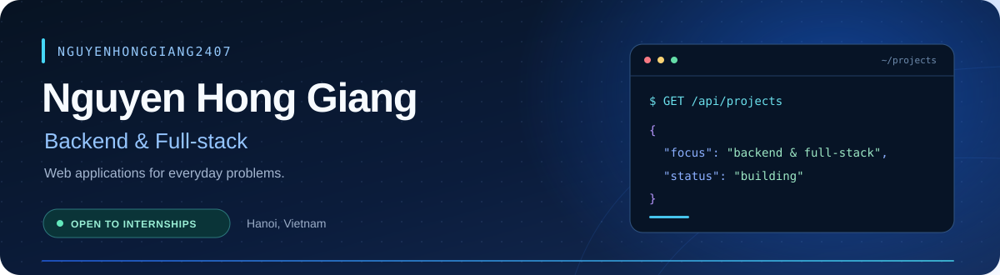

  

# Hi, I'm Nguyễn Hồng Giang

I'm an IT student in **Hanoi, Vietnam**, seeking a **part-time Java Backend / Full-stack internship**. I work with **Java 17, Spring Boot, REST APIs, and SQL**.

**YangHomestay** is my main project, with a Java booking backend currently under review. **RunwayStudio** and **YangSlots** also show how I work with checkout and reservation transactions.

[Email](mailto:nguyenhonggiang.profile@gmail.com) · [Featured projects](#featured-projects) · [More projects](docs/PROJECTS.md)

## Featured projects

### 1. YangHomestay

Hanoi homestay booking. The Java implementation uses a Spring Boot customer API with the existing HTML/CSS/JavaScript interface. PostgreSQL locks the unit when accepting a booking, rechecks availability, and stores the price of each night at the time of booking.

With stay dates, YangMatch checks availability, guest capacity, and nightly prices before ranking matching stays. Favorites belong to the signed-in customer; repeating an add request does not create a duplicate.

Java 17 · Spring Boot · Spring Security · Spring JDBC · PostgreSQL · Docker · HTML/CSS/JavaScript

[Repository](https://github.com/nguyenhonggiang2407/YangHomestay) · [Java demo](https://yanghomestay-java-demo.onrender.com/customer/) · [Java source and setup](https://github.com/nguyenhonggiang2407/YangHomestay/tree/deploy/java-portfolio-demo-2026-11-19/java-backend) · [Java/PostgreSQL checks](https://github.com/nguyenhonggiang2407/YangHomestay/actions/runs/44436759513) · [Container checks](https://github.com/nguyenhonggiang2407/YangHomestay/actions/runs/44436693882)

The [Java migration is under review](https://github.com/nguyenhonggiang2407/YangHomestay/pull/3); the default branch still contains the PHP implementation. The Java portfolio demo uses a disposable PostgreSQL database: accounts, favorites, and bookings reset on server restart. Reception is disabled publicly. The retained [PHP/Supabase demo](https://yanghomestay.helioho.st/customer/) runs separately. [Java deployment scope](https://github.com/nguyenhonggiang2407/YangHomestay/blob/deploy/java-portfolio-demo-2026-11-19/docs/java-demo-deployment.md)

### 2. RunwayStudio

Fashion storefront with a private wardrobe and cash-on-delivery checkout. The backend locks inventory rows before writing the order, inventory changes, and order history in one transaction. MySQL acceptance tests cover buyers competing for the last item, checkout retries, and stock restoration after cancellation.

Java 17 · Spring Boot · Spring Data JPA · Flyway · MySQL / H2

[Repository](https://github.com/nguyenhonggiang2407/RunwayStudio) · [Checkout walkthrough](https://github.com/nguyenhonggiang2407/RunwayStudio/blob/main/docs/ARCHITECTURE.md#checkout-đường-đọc-mã-và-bằng-chứng) · [MySQL tests](https://github.com/nguyenhonggiang2407/RunwayStudio/blob/main/src/test/java/vn/runway/store/MySqlAcceptanceIT.java) · [CI](https://github.com/nguyenhonggiang2407/RunwayStudio/actions/workflows/ci.yml) · [Demo](https://runwaystudio-portfolio-demo.onrender.com)

The project builds on an inherited storefront. Its attribution records the baseline and unresolved rights for some inherited catalog images. [Attribution](https://github.com/nguyenhonggiang2407/RunwayStudio/blob/main/docs/ATTRIBUTION.md)

### 3. YangSlots

Resource booking with five-minute holds. When time windows overlap, the backend checks peak concurrent usage before accepting a hold. Tests cover competing requests, expired holds, and retries with the same request key.

Java 17 · Spring Boot · Spring JDBC · H2 · Docker

[Repository and local setup](https://github.com/nguyenhonggiang2407/YangSlots) · [Booking service](https://github.com/nguyenhonggiang2407/YangSlots/blob/main/src/main/java/vn/yang/slots/BookingService.java) · [Reservation tests](https://github.com/nguyenhonggiang2407/YangSlots/blob/main/src/test/java/vn/yang/slots/ReservationsTest.java) · [CI](https://github.com/nguyenhonggiang2407/YangSlots/actions/workflows/ci.yml) · [Demo](https://yangslots-demo.onrender.com)

The repository preserves the original DTDD branch history and credits its MIT reference. [Source credits](https://github.com/nguyenhonggiang2407/YangSlots/blob/main/NOTICE.md)

## Full-stack and integration projects

| Project | Stack and review focus | Evidence and demo |
| --- | --- | --- |
| **4. [YangRent](https://github.com/nguyenhonggiang2407/YangRent)** | React, FastAPI, SQLAlchemy, PostgreSQL / SQLite. Rental requests, backend role checks and record ownership. | [CI](https://github.com/nguyenhonggiang2407/YangRent/actions/workflows/ci.yml) · [Demo](https://yangrent-portfolio-demo.onrender.com/) |
| **5. [CampusDesk](https://github.com/nguyenhonggiang2407/CampusDesk)** | React, TypeScript, Express, SQLite. Student/staff ticket workflows, private notes and version-based edit conflict checks. | [CI](https://github.com/nguyenhonggiang2407/CampusDesk/actions/workflows/ci.yml) · [Demo](https://giang-campusdesk.onrender.com) |
| **6. [YangHooks](https://github.com/nguyenhonggiang2407/YangHooks)** | Node.js, SQLite. Local webhook lab with HMAC verification, replay checks, and signing key rotation. | [CI](https://github.com/nguyenhonggiang2407/YangHooks/actions/workflows/ci.yml) · [Source credits](https://github.com/nguyenhonggiang2407/YangHooks/blob/main/NOTICE.md) |

Render demos can take time to start. Use fictional details; demo data can reset after a service restart. YangRent uses mock payments. The repositories document test coverage and the scope of the demos. [YangRent source and image credits](https://github.com/nguyenhonggiang2407/YangRent/blob/main/docs/source-notice.md) · [YangHomestay image credits](https://github.com/nguyenhonggiang2407/YangHomestay/blob/main/docs/image-sources.md)

RunwayStudio storefront screenshot

[See other projects, coursework, and source history](docs/PROJECTS.md)
