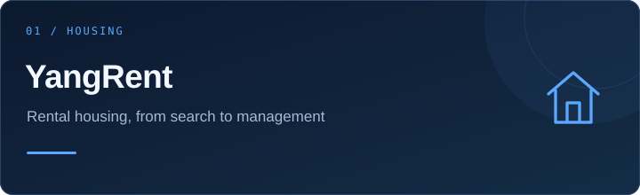
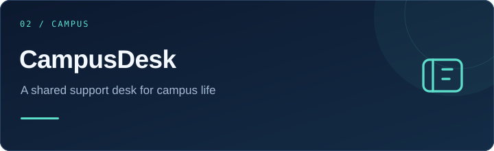
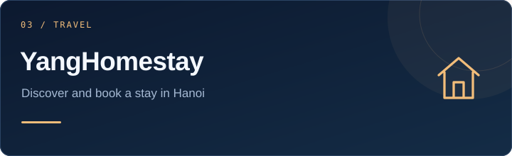
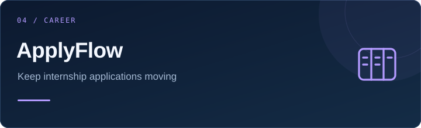
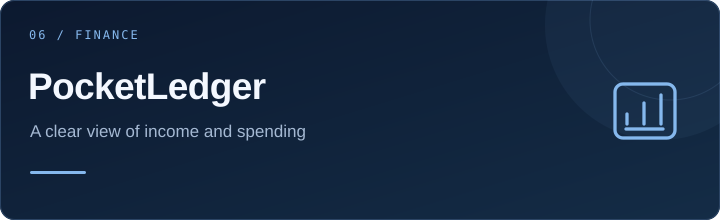
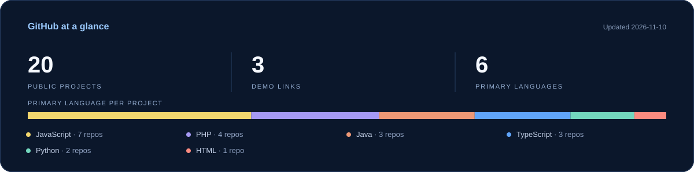

  

  

  
  
  

### Building web apps for everyday problems.

I'm **Nguyễn Hồng Giang**, an IT student in Hanoi. I work on web applications for housing, campus support, learning and student life.

- **Focus:** Backend & Full-stack development.
- **Currently learning:** Java and Spring Boot.
- **Looking for:** a part-time internship in Hanoi, with a team I can learn from.
- **I care about:** clear workflows, access control and useful interfaces.

 

### Things I build with

**Frontend**

**Backend**

**Data & tools**

**Learning**

### Selected projects

<table>
<tr>
<td width="50%" valign="top">

Find rooms, send booking requests and manage rental contracts, bills and maintenance.
  
<b>React · FastAPI · PostgreSQL</b>
  
<a href="https://github.com/nguyenhonggiang2407/YangRent">Source code ↗</a>
</td>
<td width="50%" valign="top">

Student and staff workflows, ticket assignments, private notes and conflict detection.
  
<b>React · TypeScript · Express · SQLite</b>
  
<a href="https://github.com/nguyenhonggiang2407/CampusDesk">Source code ↗</a>
</td>
</tr>
<tr>
<td width="50%" valign="top">

Explore Hanoi homestays, check availability and send booking requests with server-side pricing.
  
<b>PHP · JavaScript · Supabase PostgreSQL</b>
  
<a href="https://github.com/nguyenhonggiang2407/YangHomestay">Source code ↗</a> · <a href="https://yanghomestay.helioho.st/">Live demo ↗</a>
</td>
<td width="50%" valign="top">

Track internship applications, move them through a status pipeline and plan follow-up tasks.
  
<b>React · TypeScript · Express · SQLite</b>
  
<a href="https://github.com/nguyenhonggiang2407/ApplyFlow">Source code ↗</a>
</td>
</tr>
<tr>
<td width="50%" valign="top">

Vocabulary books, spaced review and short practice sessions with progress saved per account.
  
<b>PHP · MySQL · JavaScript</b>
  
<a href="https://github.com/nguyenhonggiang2407/YangLingo">Source code ↗</a> · <a href="https://yangcute.helioho.st/">Live demo ↗</a>
</td>
<td width="50%" valign="top">

Keep a private ledger, set category budgets and export filtered transactions to CSV.
  
<b>React · TypeScript · Express · SQLite</b>
  
<a href="https://github.com/nguyenhonggiang2407/PocketLedger">Source code ↗</a>
</td>
</tr>
</table>

Also building [YangLocal](https://github.com/nguyenhonggiang2407/YangLocal), a WordPress theme and plugin for discovering places in Hanoi. [View the demo ↗](https://nguyenhonggiangcute.helioho.st/)

### GitHub at a glance

What I'm working on next

- Building a stronger foundation in Java and Spring Boot.
- Improving database design, API validation and error handling.
- Adding useful integration tests to important workflows.
- Making projects easier to run and review.

Hanoi, Vietnam · Open to Backend & Full-stack internships

